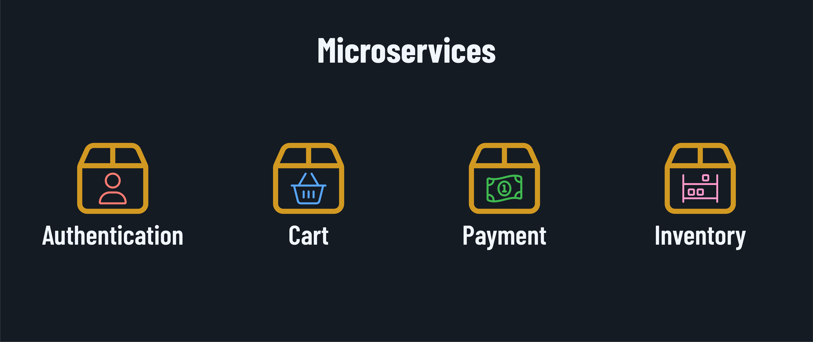

<h1>
  Containerization and Microservices
  Concepts
</h1>

**Learning Objective:** By the end of this lesson, students will be able to define containerized microservices and explain their role in modern application development and deployment.

## What are containerized microservices?

Imagine you're building a city, but instead of constructing massive, monolithic buildings, you create smaller, modular structures that can be easily assembled and rearranged. That's the essence of containerized microservices!

In software development, containerized microservices are like Lego blocks for building applications. Each microservice is a small, independent unit focused on a specific function or business capability. These microservices are packaged into containers, which are lightweight, portable, and self-sufficient environments that include everything needed to run the service.

In the image above, there's an example of some microservices that are part of a shopping platform. Each microservice is responsible for a specific function, such as user authentication, or payment processing. These microservices communicate with each other through *APIs* (Application Programming Interfaces) to create a cohesive application.

Containerization technologies like Docker provide a standardized way to package and deploy microservices. Containers ensure that microservices can run consistently across different environments, from development to production, without worrying about dependencies or conflicts.

## Why use containerized microservices?

By breaking down an application into smaller, containerized microservices, developers can:

- Develop, deploy, and scale services independently.

- Use different technologies and languages for each microservice.

- Update and maintain services without affecting the entire application.

- Achieve faster development cycles and more frequent releases.

Containerized microservices are like a symphony orchestra, where each musician plays a specific part, creating a beautiful, harmonious application together.

  <h2 class="title">Identifying microservices</h2>
  5 min

We've already seen some microservices in the shopping platform example above. Let's discuss other examples of microservices that might be part of this shopping platform.
